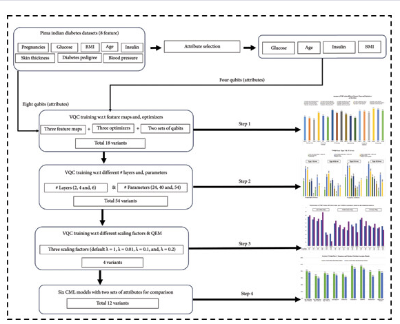
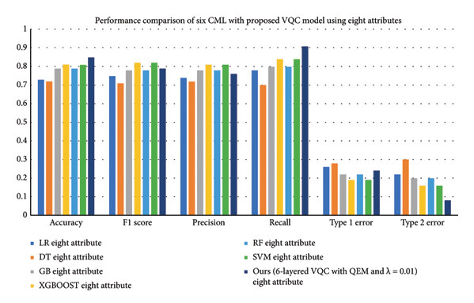
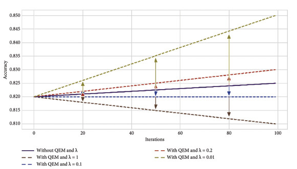
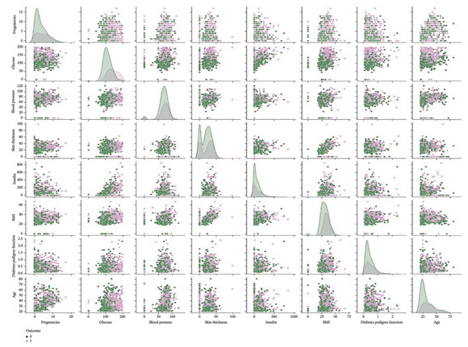
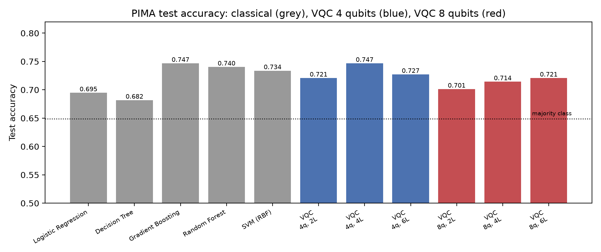

# Quantum Diabetes Prediction

An **optimized variational quantum classifier (VQC)** for diabetes prediction on the PIMA Indian Diabetes dataset,
comparing qubit counts, circuit depth and feature maps with classical classifiers.



## Method
1. **Pre-processing**: impossible zeros (glucose, blood pressure, skin thickness, insulin, BMI) → training-set median;
   standardise; scale to [0, π]. **8 qubits** use all 8 attributes; **4 qubits** use the attributes selected in the
   study (**Glucose, Age, Insulin, BMI**), or an ANOVA F-test selection with `--attributes select`.
2. **Feature map**: ZZ feature map (2 repetitions, linear entanglement); inputs scaled by a bandwidth factor chosen
   on a validation split (the full [0, π] range leaves the VQC near chance).
3. **Ansatz**: RealAmplitudes with *L* ∈ {2, 4, 6} layers, linear entanglement; parity readout.
4. **Training**: Adam on binary cross-entropy through an exact PyTorch statevector simulation (`vqc_torch.py`,
   verified against Qiskit to 1e-9); COBYLA via qiskit-machine-learning is available with `--optimizer cobyla`.
5. **Evaluation**: stratified 80 / 20 split; accuracy, precision, recall, F1, ROC-AUC vs. logistic regression,
   RBF-SVM and random forest.

## Published Study Design
As shown in the workflow above, the paper evaluates:
1. **18 variants**: three feature maps × three optimizers × two attribute sets (8 and 4 qubits);
2. **54 variants**: 2, 4 and 6 layers with 24, 40 and 54 trainable parameters;
3. **Quantum error mitigation (QEM)** with scaling factors λ ∈ {1, 0.2, 0.1, 0.01};
4. **Six classical models** (LR, DT, GB, XGBoost, RF, SVM) on both attribute sets for comparison.

## Published Figures
The best model, a **6-layer VQC with QEM and λ = 0.01 on eight attributes**, gives the highest accuracy and recall of
all models compared:



Effect of quantum error mitigation and the scaling factor λ on accuracy over training iterations:



Pairwise distributions of the eight PIMA attributes by outcome:



*Figures reproduced from Khan et al., "Diabetes Prediction Using an Optimized Variational Quantum Classifier",
International Journal of Intelligent Systems, 2025, [doi:10.1155/int/1351522](https://doi.org/10.1155/int/1351522),
published open access under the [CC BY 4.0](https://creativecommons.org/licenses/by/4.0/) license.*

## Repository Structure
```
Quantum-Diabetes-Prediction/
├── Code/
│   ├── data.py            # loading, imputation, feature selection, angle scaling
│   ├── vqc.py             # qiskit-machine-learning VQC (COBYLA)
│   ├── vqc_torch.py       # same circuit, differentiable PyTorch simulation (Adam) + Qiskit export
│   ├── test_vqc_torch.py  # equivalence test against Qiskit
│   ├── train.py           # quantum and classical experiments -> Results/results.json
│   ├── plot_results.py    # comparison, training curves, circuit diagrams
│   └── requirements.txt
├── Dataset/               # pima-indians-diabetes.csv + description
├── Figures/
│   └── paper/             # figures from the published article (CC BY 4.0)
├── Results/
├── LICENSE
└── README.md
```

## Quick Start
```bash
cd Code
pip install -r requirements.txt
python -m pytest test_vqc_torch.py
python train.py                                        # 4 and 8 qubits, 2/4/6 layers, Adam
python train.py --optimizer cobyla --maxiter 300       # qiskit-machine-learning VQC
python plot_results.py
```

## Publication
**Diabetes Prediction Using an Optimized Variational Quantum Classifier**  
*International Journal of Intelligent Systems*, 2025. DOI: [10.1155/int/1351522](https://doi.org/10.1155/int/1351522)  
Reported: a VQC with six layers and a ZZ feature map reached **0.85 accuracy with 8 qubits** and **0.80 with 4 qubits**.

## Results


Reproduced here: VQC test accuracy **0.70–0.75**, on par with classical models (0.68–0.75). Full tables and a comparison
with the published numbers are in [Results/README.md](Results/README.md).

## Author
**Wajiha Rahim Khan**  
[Google Scholar](https://scholar.google.com/citations?user=ctvOkbYAAAAJ)

## License
MIT. See [LICENSE](LICENSE).
