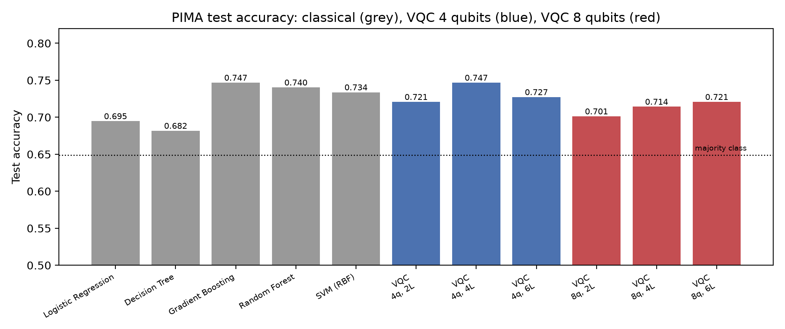
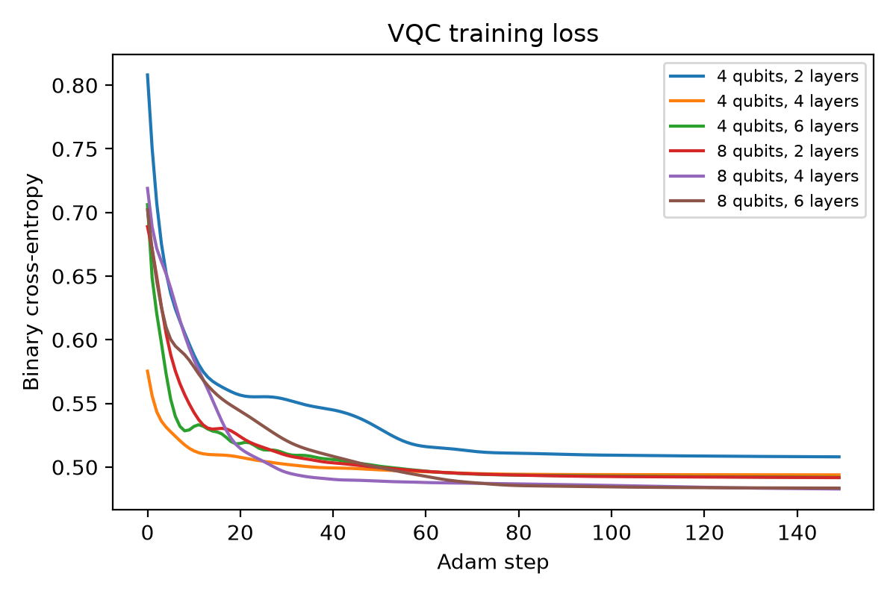

# Results

## Published (Khan et al., Int. J. Intelligent Systems, 2025)
- 6-layer VQC with ZZ feature map: **0.85 accuracy with 8 qubits**, **0.80 with 4 qubits** (Glucose, Age, Insulin, BMI).
- Best model: 6-layer VQC with quantum error mitigation (QEM) and scaling factor λ = 0.01 on eight attributes,
  outperforming LR, DT, GB, XGBoost, RF and SVM (see `Figures/paper/`).

## Reproduced with this code
Exact statevector simulation, stratified 80 / 20 split (seed 42, 614 train / 154 test), Adam
(150 full-batch steps, lr 0.05). Input bandwidth chosen on a validation split of the training data.

| Model | Accuracy | Precision | Recall | F1 | ROC-AUC |
|---|---|---|---|---|---|
| Logistic Regression | 0.695 | 0.575 | 0.500 | 0.535 | 0.812 |
| Decision Tree | 0.682 | 0.553 | 0.481 | 0.515 | 0.636 |
| Gradient Boosting | 0.747 | 0.674 | 0.537 | 0.598 | 0.830 |
| Random Forest | 0.740 | 0.659 | 0.537 | 0.592 | 0.816 |
| SVM (RBF) | 0.734 | 0.644 | 0.537 | 0.586 | 0.801 |
| VQC-ZZ, 4 qubits, 2 layers (bandwidth 0.1) | 0.721 | 0.704 | 0.352 | 0.469 | 0.791 |
| VQC-ZZ, 4 qubits, 4 layers (bandwidth 0.1) | 0.747 | 0.727 | 0.444 | 0.552 | 0.803 |
| VQC-ZZ, 4 qubits, 6 layers (bandwidth 0.1) | 0.727 | 0.688 | 0.407 | 0.512 | 0.784 |
| VQC-ZZ, 8 qubits, 2 layers (bandwidth 0.1) | 0.701 | 0.591 | 0.481 | 0.531 | 0.777 |
| VQC-ZZ, 8 qubits, 4 layers (bandwidth 0.1) | 0.714 | 0.604 | 0.537 | 0.569 | 0.774 |
| VQC-ZZ, 8 qubits, 6 layers (bandwidth 0.1) | 0.721 | 0.622 | 0.518 | 0.566 | 0.778 |

Majority-class baseline (always "no diabetes"): 0.649.

### Notes
- **Input bandwidth is essential.** Mapping features to the full [0, π] range before the ZZ feature map leaves the
  VQC at chance (validation accuracy ≈ 0.53–0.56). Scaling to [0, 0.1π] raises it to ≈ 0.80–0.85 on validation and
  0.70–0.75 on test.
- **Gradient training matters.** The same circuit trained with COBYLA for 300 iterations
  (`python train.py --optimizer cobyla`) reached only 0.64 (4 qubits) and 0.56 (8 qubits) test accuracy.
- On this split the VQC is **on par with the classical models** (best: 4 qubits, 4 layers, 0.747, tied with
  gradient boosting). The published 0.85 was obtained with a different protocol (optimizer study, QEM with a tuned
  scaling factor, and its own data split), which is not reproduced here.

## Files
- `results.json`: all metrics, selected bandwidths, validation grid and loss curves.
